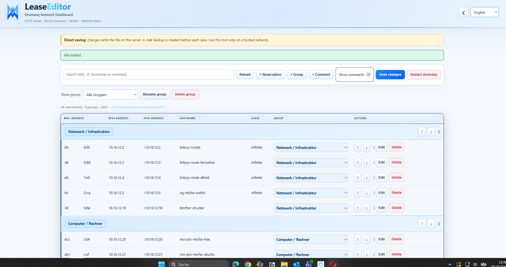

<p align="center">
  <a href="https://github.com/anonymous-writer/LeaseEditor-Dnsmasq"></a>
  <a href="https://hub.docker.com/r/anonymouswriter/leaseeditor-dnsmasq"></a>
  <a href="https://github.com/anonymous-writer/LeaseEditor-Dnsmasq/pkgs/container/leaseeditor-dnsmasq"></a>
  
  <a href="LICENSE"></a>
</p>

# LeaseEditor-Dnsmasq

**Your network. Your reservations. Clearly managed.**

<p align="center">
  
</p>

LeaseEditor-Dnsmasq is a lightweight Go web application for editing static DHCP reservations in a `dnsmasq` hosts file. It provides a browser-based interface for managing reservations, comments, and groups without manually editing the file line by line.

## Project links

- [GitHub repository and documentation](https://github.com/anonymous-writer/LeaseEditor-Dnsmasq)
- [Docker Hub image](https://hub.docker.com/r/anonymouswriter/leaseeditor-dnsmasq)
- [GHCR Docker image](https://github.com/anonymous-writer/LeaseEditor-Dnsmasq/pkgs/container/leaseeditor-dnsmasq)
- [Related project: LeaseLens-Dnsmasq](https://github.com/anonymous-writer/LeaseLens-Dnsmasq) — a dashboard for viewing and monitoring DHCP leases.
- [MIT License](LICENSE)

<p align="center">
  
</p>

## Features

- Read and edit the configured `dnsmasq.dhcphosts` file.
- Add, edit, and delete static DHCP reservations.
- Manage comment lines and group headings, including moving comments up and down.
- Assign reservations to groups and filter the table by group.
- Search reservations and comments.
- Preserve comments and unrecognized lines when saving, where supported by the file parser.
- Suggest IPv4 addresses based on addresses found in the current reservation file.
- Dark/light theme and English, German, and Spanish interface options.
- Create a `.bak` backup before saving changes.
- Optional button to restart the host's `dnsmasq` service in native Linux/systemd installations.
- Configurable log levels: `DEBUG`, `INFO`, `WARN`, and `ERROR`.
- Multi-architecture Docker image for `linux/amd64` and `linux/arm64`, published to GitHub Container Registry (GHCR) on GitHub Releases.

> **Important:** LeaseEditor edits the static DHCP hosts file. It does not directly rewrite `dnsmasq.leases`; that file is maintained by dnsmasq and contains active DHCP lease information.

## Quick start — Docker

The release workflow publishes multi-architecture images to GitHub Container Registry. Pull the latest stable image:

```bash
docker pull ghcr.io/anonymous-writer/leaseeditor-dnsmasq:latest
```

Create a working directory for `config.yaml` and `compose.yaml`. Make sure the configured hosts file exists and that the container's application user can write to it and its parent directory.

Example `config.yaml`:

```yaml
hosts_file: "/var/lib/dnsmasq/dnsmasq.dhcphosts"
host: "0.0.0.0"
port: "3009"
```

Example `compose.yaml`:

```yaml
services:
  leaseeditor-dnsmasq:
    image: ghcr.io/anonymous-writer/leaseeditor-dnsmasq:latest
    container_name: leaseeditor-dnsmasq
    restart: unless-stopped
    environment:
      LOG_LEVEL: "INFO"
    ports:
      - "3009:3009"
    volumes:
      - ./config.yaml:/app/config.yaml:ro
      - /var/lib/dnsmasq:/var/lib/dnsmasq:rw
```

Adjust `/var/lib/dnsmasq` to the directory that contains your `dnsmasq.dhcphosts` file. The directory is mounted read-write because LeaseEditor must save the hosts file and create `.bak` backups.

Start the application:

```bash
docker compose up -d
```

Open **http://YOUR_HOST:3009**, replacing `YOUR_HOST` with the address of the Docker host.

### File permissions

The container runs as a non-root user. Ensure the mounted directory and hosts file permissions allow that user to write changes. Use an appropriate group or ownership arrangement; do not make the file world-writable to work around permission problems.

## Configuration

The Docker image uses the same flat YAML-style configuration file as the native Linux binary.

| Key | Default | Description |
|---|---|---|
| `hosts_file` | `/var/lib/dnsmasq/dnsmasq.dhcphosts` | Path to the static DHCP hosts file that LeaseEditor edits |
| `host` | `127.0.0.1` | Address the web server listens on |
| `port` | `3009` | TCP port for the web interface |
| `log_level` | `INFO` | Minimum log level: `DEBUG`, `INFO`, `WARN`, or `ERROR` |
| `https-secure` | `false` | Require a trusted local HTTPS reverse proxy |
| `https-secure-token-file` | `/etc/nginx/secrets/leaseeditor-proxy-token.json` | Rotating token state file (application writes; NGINX reads) |
| `https-secure-token-validity` | `720h` | Token lifetime / rotation interval |
| `https-secure-token-grace` | `5m` | Previous-token acceptance window |

The `LOG_LEVEL` environment variable can also set the minimum log level. If both the configuration value and environment variable are supplied, the environment variable takes precedence.

## HTTPS-secure mode behind NGINX

For deployments behind a trusted local NGINX/OpenResty reverse proxy, set `https-secure: true` in `config.yaml`.

LeaseEditor creates a separate random 100-character token in the configured JSON file and rotates it every 30 days by default. Include `nginx/proxy-token.lua.conf` in the OpenResty proxied location. The Lua configuration reads the current token on every request, so token rotation does not require an NGINX reload. The backend accepts the previous token for the configured five-minute grace period.

Ensure the application can write the token file and NGINX can read it (file mode `0640`, shared group; use a setgid directory or equivalent group ownership). For Docker, make the token file's parent directory available to both containers through an appropriately permissioned shared mount, and set `https-secure-token-file` to the path visible inside the LeaseEditor container.

Keep the application bound to `127.0.0.1` when the proxy is on the same host. Authelia remains the authentication layer; this token only authenticates the local proxy hop.

## Logging and troubleshooting

LeaseEditor writes timestamped log messages with severity levels to standard output. Follow the Docker Compose logs with:

```bash
docker compose logs -f leaseeditor-dnsmasq
```

Available log levels:

| `LOG_LEVEL` | Messages | Typical use |
|---|---|---|
| `DEBUG` | Debug, info, warnings, and errors | Temporary troubleshooting |
| `INFO` | Info, warnings, and errors | Normal operation (default) |
| `WARN` | Warnings and errors | Quieter operation |
| `ERROR` | Errors only | Important failures only |

To enable more detailed logging, set this in the Compose file:

```yaml
environment:
  LOG_LEVEL: "DEBUG"
```

Recreate the service after changing its environment:

```bash
docker compose up -d --force-recreate
```

Avoid sharing logs publicly without checking them for sensitive infrastructure details.

## Restarting dnsmasq

The **Restart dnsmasq** button is intended for native Linux installations using systemd. It runs the fixed command `systemctl restart dnsmasq` and requires the included sudoers rule to be installed and configured for the actual service account.

The button cannot restart the host's dnsmasq service from inside Docker. For Docker deployments, restart dnsmasq on the host using the host's normal administration tools.

## Security

LeaseEditor has no built-in user authentication. It can modify a network's DHCP reservation file, so treat it as an administrative tool:

- Keep it on a trusted LAN or behind an authenticated reverse proxy.
- Do not expose it directly to the public internet.
- Restrict write permissions to the required hosts file and directory.
- Use the HTTPS-secure proxy mode only with a trusted local reverse proxy and correctly protected token file.
- Keep backups of your dnsmasq configuration.

## License

MIT — see [LICENSE](LICENSE).
